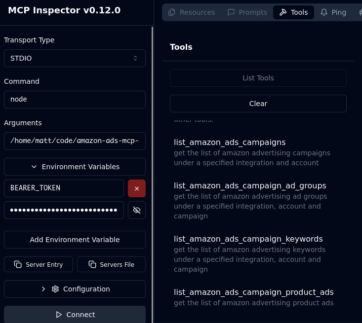

# Marketplace Ad Pros MCP Server for Amazon Ads & Seller Central

A hosted MCP server that connects your Amazon Ads, Seller Central, Vendor Central and Amazon Marketing Cloud data to Claude, ChatGPT, Claude Code, Cursor, n8n and any other MCP-compatible client. Built by [Marketplace Ad Pros](https://marketplaceadpros.com?ref=github-amazon-ads-mcp-server), an Amazon Ads Verified Partner.

**Remote endpoint (Streamable HTTP, OAuth):**

```
https://app.marketplaceadpros.com/mcp
```

There's nothing to install and no API key to copy. Add the URL to your client, sign in, and connect your Amazon accounts. Access is read-only by default. Write access, such as changing bids, budgets, keywords or listings, is opt-in, and each change asks you to confirm it.

Registry name: `com.marketplaceadpros/amazon-ads`

## What you can do with it

- **Amazon Ads:** Sponsored Products, Sponsored Brands and Sponsored Display campaigns, ad groups, keywords, targets, product ads and portfolios, plus Amazon DSP. Ask about performance in plain English: ACoS, ROAS, spend, search terms, wasted spend, placement and budget pacing.
- **Seller Central & Vendor Central (Selling Partner API):** total sales, units, sessions and conversion, TACoS, orders, inventory and FBA, listings, Search Query Performance, Brand Analytics, settlements and fees.
- **Amazon Marketing Cloud (AMC):** run AMC SQL and curated AMC reports.
- **Optimization:** daily recommendations, experiments with measured outcomes, budget and bid recommendations from Amazon, and stock- and Buy Box-aware guidance.
- **Multi-account:** one connection covers every region (NA, EU, FE) and every profile you have access to. You can group ad accounts into brands, which suits agencies.

## Connect

### Claude (claude.ai, Claude Desktop)

Go to **Settings → Connectors → Add custom connector**, paste `https://app.marketplaceadpros.com/mcp`, and sign in when prompted.

### Claude Code

```bash
claude mcp add --transport http marketplace-ad-pros https://app.marketplaceadpros.com/mcp
```

Then run `/mcp` inside Claude Code to authenticate.

### ChatGPT

Add a custom connector (app) with the URL `https://app.marketplaceadpros.com/mcp` and sign in when prompted.

### Cursor, VS Code, Windsurf and other JSON-configured clients

```json
{
  "mcpServers": {
    "marketplace-ad-pros": {
      "type": "streamable-http",
      "url": "https://app.marketplaceadpros.com/mcp"
    }
  }
}
```

### Clients without OAuth (n8n, LibreChat, scripts)

Create an API token in the Marketplace Ad Pros app and send it as a bearer token:

```yaml
  MAP:
    type: streamable-http
    url: https://app.marketplaceadpros.com/mcp
    headers:
      Authorization: "Bearer <your token>"
```

## Pricing

Signing up and connecting your Amazon accounts is free. MCP access starts at $10/week on the AI Connect plan. See [pricing](https://marketplaceadpros.com/plans/?ref=github-amazon-ads-mcp-server).

## Legacy: local stdio bridge (npm)

This repository also contains `@marketplaceadpros/amazon-ads-mcp-server`, a small stdio bridge from 2025 for clients that couldn't connect to remote MCP servers. It forwards every call to the remote endpoint above. Most clients can now connect to that endpoint directly, so use it, and keep the bridge only for clients that need stdio.

<details>
<summary>stdio bridge setup</summary>

Set `BEARER_TOKEN` to an API token from Marketplace Ad Pros:

```json
{
  "mcpServers": {
    "marketplaceadpros": {
      "command": "npx",
      "args": ["@marketplaceadpros/amazon-ads-mcp-server"],
      "env": {
        "BEARER_TOKEN": "<your token>"
      }
    }
  }
}
```

To build from source:

```bash
npm install
npm run build      # or: npm run watch
npm run inspector  # debug with the MCP Inspector
```



</details>

## Links

- Website: https://marketplaceadpros.com?ref=github-amazon-ads-mcp-server
- Setup guides: https://marketplaceadpros.com/integrations/?ref=github-amazon-ads-mcp-server
- Support: info@marketplaceadpros.com

## Acknowledgements

- The Model Context Protocol and Anthropic teams for the [MCP specification](https://modelcontextprotocol.io/introduction).
